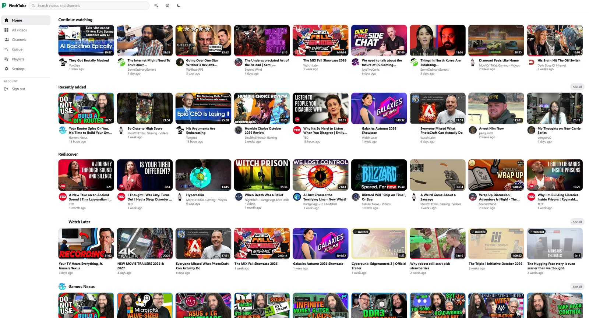
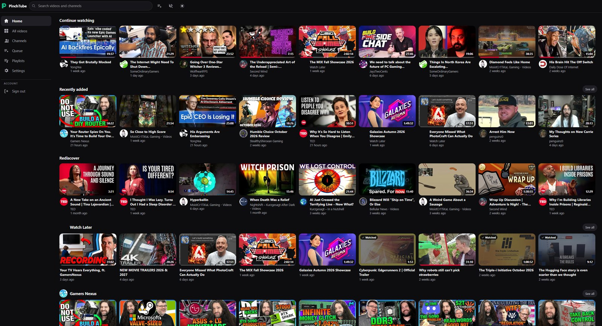
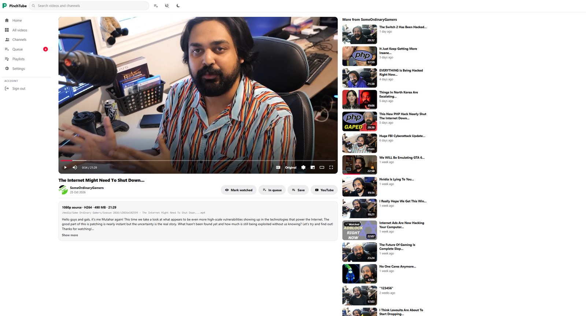
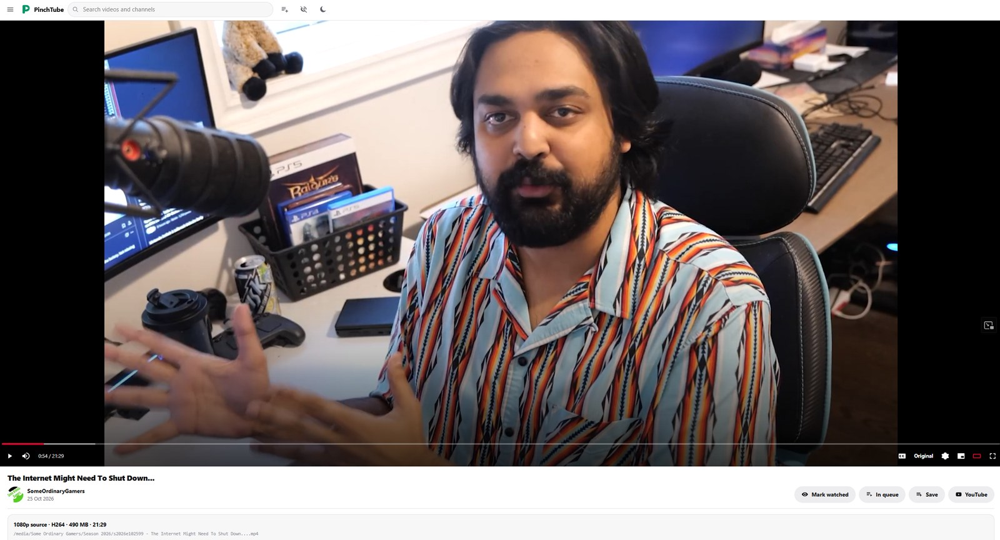
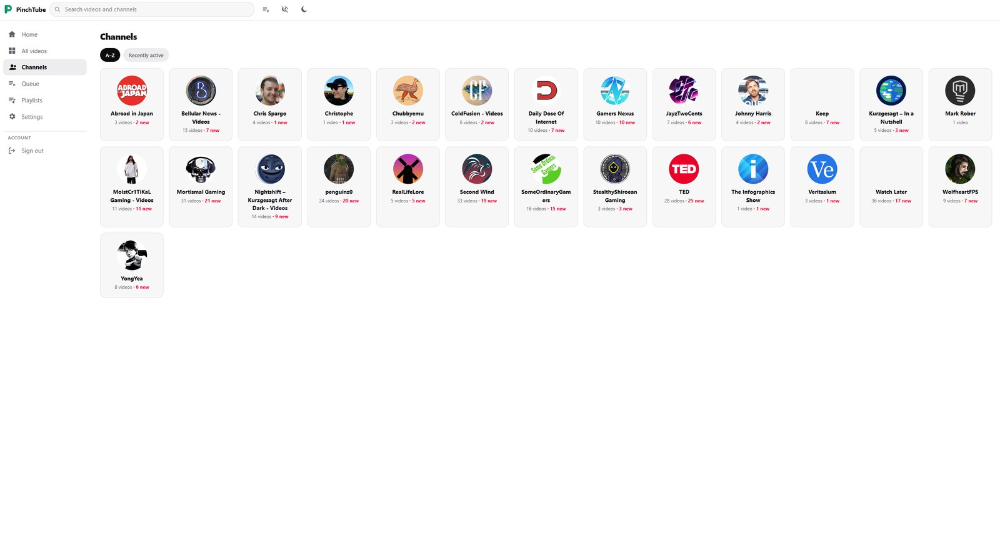
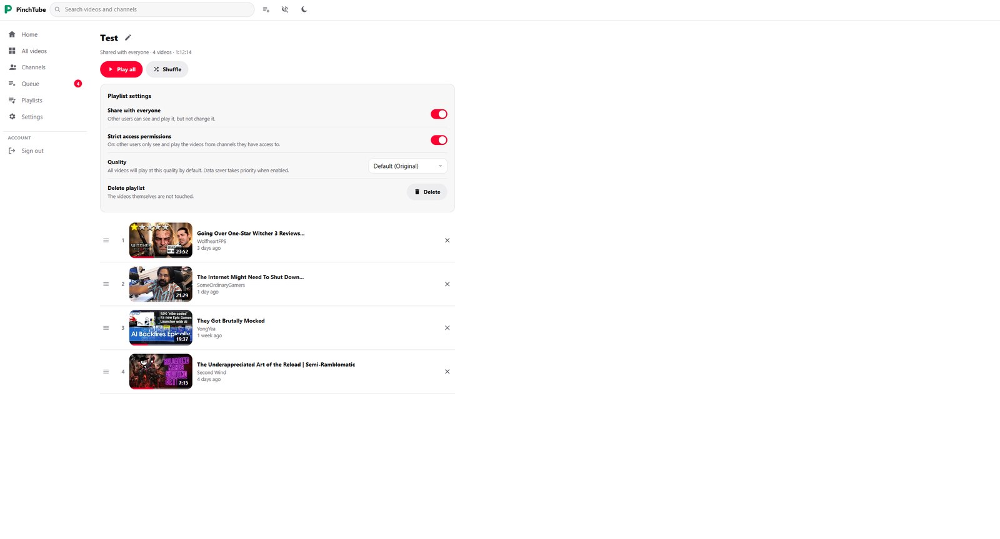
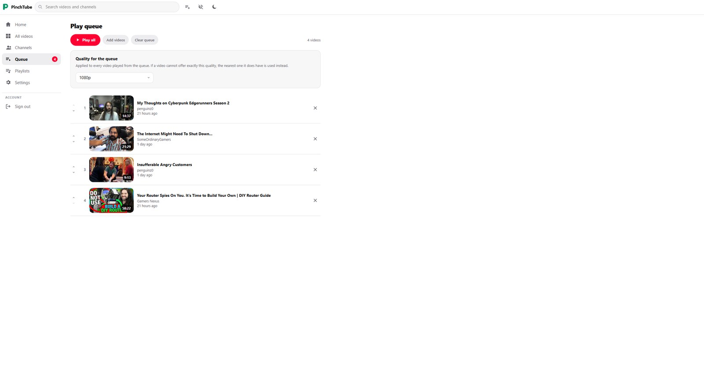
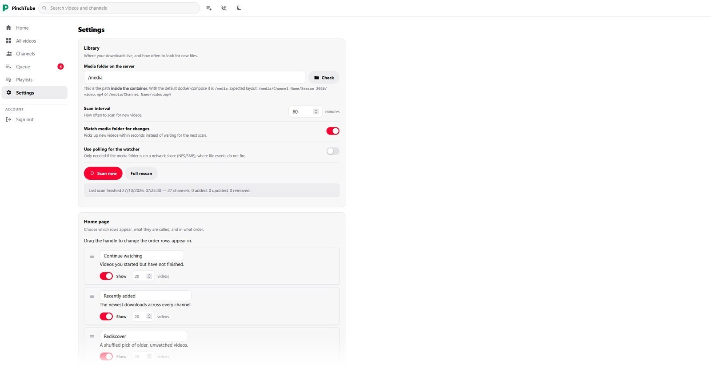
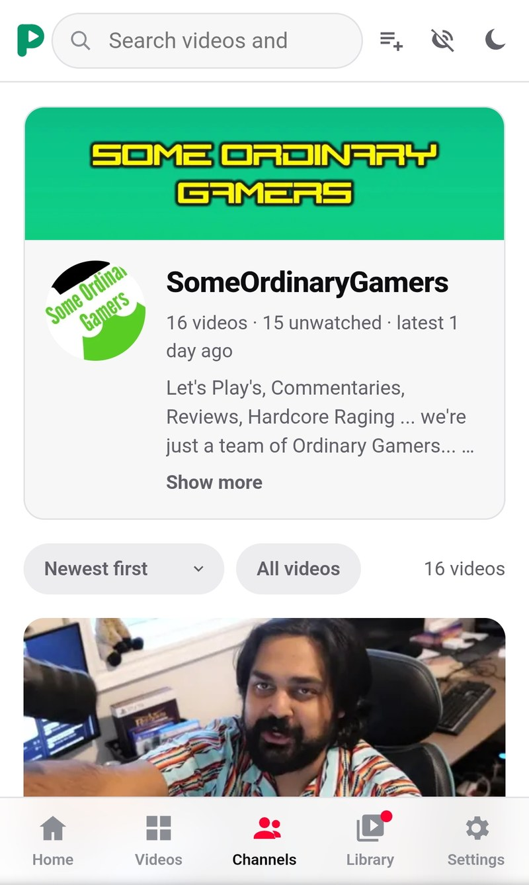
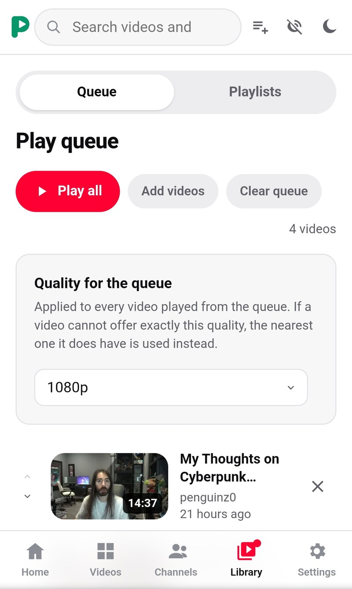

<p align="center">
  <picture>
    <source media="(prefers-color-scheme: dark)" srcset="docs/assets/logo-dark.svg">
    <source media="(prefers-color-scheme: light)" srcset="docs/assets/logo-light.svg">
    
  </picture>
</p>

<p align="center">
  <strong>A self-hosted media server for your Pinchflat video library.</strong>
</p>

<p align="center">
  
  
  
  
  <a href="LICENSE"></a>
</p>

<p align="center">
  <a href="#screenshots">Screenshots</a> ·
  <a href="#features">Features</a> ·
  <a href="#requirements">Requirements</a> ·
  <a href="#installation">Installation</a> ·
  <a href="docs/GUIDE.md">Full guide</a>
</p>

## About

PinchTube is a self-hosted web app that turns a folder of videos into a familiar,
easy-to-browse streaming site. Point it at a library organised by
[Pinchflat](https://github.com/kieraneglin/pinchflat) or [Pinchflat-NGX](https://github.com/TheBadFella/pinchflat-ngx) and it reads the channels, titles,
descriptions and artwork straight from the files, with nothing copied or changed. You get a home page of rows, channel pages, search, playlists and a player with a
proper quality menu that transcodes on the fly, so the same library plays smoothly on a
desktop or on a phone on mobile data. It runs as a single Docker container on
your own server, with accounts for everyone in the house.

## Screenshots

Click any screenshot to see it full size.

<table>
  <tr>
    <th width="50%"><a href="docs/assets/screenshots/home.jpg">Home</a></th>
    <th width="50%"><a href="docs/assets/screenshots/home-dark.jpg">Home (dark theme)</a></th>
  </tr>
  <tr>
    <td><a href="docs/assets/screenshots/home.jpg"></a></td>
    <td><a href="docs/assets/screenshots/home-dark.jpg"></a></td>
  </tr>
  <tr>
    <th><a href="docs/assets/screenshots/watch.jpg">Watch page</a></th>
    <th><a href="docs/assets/screenshots/theater.jpg">Theater mode</a></th>
  </tr>
  <tr>
    <td><a href="docs/assets/screenshots/watch.jpg"></a></td>
    <td><a href="docs/assets/screenshots/theater.jpg"></a></td>
  </tr>
  <tr>
    <th><a href="docs/assets/screenshots/channels.jpg">Channels</a></th>
    <th><a href="docs/assets/screenshots/playlist.jpg">Playlists</a></th>
  </tr>
  <tr>
    <td><a href="docs/assets/screenshots/channels.jpg"></a></td>
    <td><a href="docs/assets/screenshots/playlist.jpg"></a></td>
  </tr>
  <tr>
    <th><a href="docs/assets/screenshots/queue.jpg">Play queue</a></th>
    <th><a href="docs/assets/screenshots/settings.jpg">Settings</a></th>
  </tr>
  <tr>
    <td><a href="docs/assets/screenshots/queue.jpg"></a></td>
    <td><a href="docs/assets/screenshots/settings.jpg"></a></td>
  </tr>
  <tr>
    <th colspan="2">On your phone</th>
  </tr>
  <tr>
    <td colspan="2" align="center">
      <a href="docs/assets/screenshots/mobile-channel.jpg"></a>
      &nbsp;&nbsp;&nbsp;&nbsp;&nbsp;&nbsp;&nbsp;&nbsp;&nbsp;&nbsp;&nbsp;&nbsp;&nbsp;&nbsp;&nbsp;&nbsp;&nbsp;&nbsp;&nbsp;&nbsp;
      <a href="docs/assets/screenshots/mobile-queue.jpg"></a>
    </td>
  </tr>
</table>

## AI Disclosure

PinchTube was majority written and coded by Claude Code (Opus 5.5). While I am technical and am able to code myself, this is a project I really wanted to create and coding everything myself would have taken me far longer than I have time to spare at the moment. I understand some may have an issue with AI being used and I ask that if you don't like the project, please don't use it. I am however very open to feedback and suggestions, and am keen to see PinchTube succeed!

I would like to mention however that since the code is written by Claude and I'm no security auditor, **I do not recommend hosting PinchTube publicly**. Please host it on your local LAN and use a VPN like Wireguard/Tailscale if you wish to access it remotely.

Thank you!

## Features

- **YouTube as it should be** - No ads, no algorithms predicting your likes, no social media
  rubbish or arguments in the comments, just your own YouTube server as you like it.
- **A familiar and customisable home page** - Continue watching, Recently added, Rediscover and a row per
  channel, all reorderable and switchable per user. Dark and Light modes.
- **Reads your library in place** - channels, titles, descriptions, dates and artwork from
  Kodi-style `.nfo` and image files, plus chapters and subtitles; the media folder is
  mounted read-only.
- **Grabs videos fast** - new videos appear within seconds, with a scheduled
  scan as a safety net.
- **All the qualities** - direct play of the original file, or on-demand transcoding
  from 2160p down to 360p plus an audio-only mode for saving mobile data.
- **Hardware transcoding** - AMD (VAAPI), Intel (Quick Sync) and NVIDIA (NVENC), tested
  automatically at start-up with a fallback to CPU software transcoding.
- **Playlists and play queue** - drag to reorder, loop, shuffle, per-person quality, and
  optional sharing with the other users.
- **Multiple users** - everyone gets their own watch history, queue, playlists and settings;
  administrators choose which channels each person can see.
- **Built for phones** - bottom tab bar, touch gestures, a data saver mode with its own
  quality, and installable to the home screen.
- **A proper player** - resume where you left off, chapters, SponsorBlock segments skipped
  automatically or with a button, theater mode, keyboard shortcuts and media controls on the
  lock screen.
- **Make it yours** - light and dark themes, your own accent colour, card sizes and a
  home page laid out the way you like.
- **Private and secure** - optional two-factor sign-in with any authenticator app, scrypt
  password hashing, sign-in throttling and strict security headers.

## Requirements

| Component | Requirement |
| --- | --- |
| **Host** | A Linux machine running [Docker Engine](https://docs.docker.com/engine/install/) with the Compose plugin (`docker compose`) |
| **CPU** | x86-64. A few cores is plenty; transcoding without a GPU is the heaviest job |
| **Memory** | 1 GB free is comfortable |
| **Disk** | Space for the transcode cache — 20 GB by default, adjustable in settings |
| **Library** | A video library organised by [Pinchflat](https://github.com/kieraneglin/pinchflat) or [Pinchflat-NGX](https://github.com/TheBadFella/pinchflat-ngx), or any folder of videos with Kodi-style `.nfo` files |
| **GPU/APU** *(optional but recommended)* | AMD or Intel with `/dev/dri`, or NVIDIA with the [NVIDIA Container Toolkit](https://docs.nvidia.com/datacenter/cloud-native/container-toolkit/latest/install-guide.html) |
| **Browser** | Any current version of Chrome, Edge, Firefox or Safari, on desktop or mobile |

## Installation

### Set up Pinchflat/Pinchflat-NGX
> Pinchflat is not required, but without it you'll need to set up all the
> paths, permissions and directories yourself or have another media
> management client which is able to do so. See the [Guide](docs/GUIDE.md) for
> more information.

1. First follow the instructions detailed on [Pinchflat](https://github.com/kieraneglin/pinchflat) or [Pinchflat-NGX](https://github.com/TheBadFella/pinchflat-ngx) to setup and install Pinchflat. Make a note of where you set your `/downloads` volume as PinchTube will need read access to the same directory. For this example, assuming you created `/YouTube` on your server to store your videos, you would set the following in your Pinchflat docker-compose.yaml:
```bash
volumes:
    - ./config:/config
    - /YouTube:/downloads
```
2. Now create a media profile for the content (channels or playlists) you wish to download. For the media to be recognised by PinchTube, it should be organised in either of the following formats:

   
`/Downloads Folder/Channel Name/Season 2026/video.mp4`


`/Downloads Folder/Channel Name/video.mp4`


Pinchflat and Pinchflat-NGX both provide a preset called 'Media Center' to pre-populate most of what you need, select this under presets. But the important part is the 'Output path template' which you should set to: `/{{ source_custom_name }}/{{ season_by_year__episode_by_date_and_index }} - {{ title }}.{{ ext }}` which would place your channel folders directly in the 'YouTube' folder.

Other settings can be configured as you wish but the following settings I would recommend:
```
Download Subtitles: On
Embed Subtitles: On
Subtitle Languages: en-orig (just 'en' seems to fail sometimes)
Download Thumbnail: On
Embed Thumbnail: On
Download Metadata: Off
Embed Metadata: On
Redownload Delay (days): 1
Create NFO data: On
Download Series Images: On
Sponsorblock: I'd recommend marking rather than removing, PinchTube can recognise marked segments
```
3. Next add your sources, these are channels or playlists you wish to download. Follow the normal process in Pinchflat to add these. If you have channel(s) that upload frequently or you want to add many channels, I'd also recommend setting up Fast Indexing but this requires a YouTube [API key](https://github.com/kieraneglin/pinchflat/wiki/Generating-a-YouTube-API-key).

4. Finally confirm that Pinchflat is downloading media correctly. Note that indexing a channel, especially without Fast Indexing, can take quite a while for larger channels, be patient! Once indexed it should start downloading. Confirm the video files land fine, you should end up with the following format if set up like in step 2 above:

```
Channel Name/  
  tvshow.nfo                     
  poster.jpg                      
  Season 2026/                   
    video.mp4                      
    video.nfo                       
    video-thumb.jpg
```

### 1. Download PinchTube

PinchTube is published as a ready-made image, so all you need is a compose file. Change
`./media` under `volumes:` to your downloads folder; everything else works as it is.

```bash
mkdir pinchtube && cd pinchtube
touch docker-compose.yaml
nano docker-compose.yaml
```
Compose file:
```yml
services:
  pinchtube:
    image: ghcr.io/cosmicthing2/pinchtube:latest
    container_name: pinchtube
    restart: unless-stopped
    ports:
      # Opens PinchTube on port 8150. Use "127.0.0.1:8150:8080" instead to only
      # accept connections from this machine, e.g. behind a reverse proxy.
      - "8150:8080"

    environment:
      # The user the app runs as, needs read access to media folder
      PUID: 1000
      PGID: 1000
      
      # Timezone
      TZ: Etc/UTC
      
      # "auto" marks the session cookie Secure whenever the request arrived
      # over HTTPS. Force with "true" / "false" if you need to.
      SECURE_COOKIES: auto
      
      # Set to "true" when a reverse proxy (Caddy, nginx, Traefik) sits in
      # front, so X-Forwarded-For / X-Forwarded-Proto are believed.
      TRUST_PROXY: "false"
      LOG_LEVEL: info

    volumes:
      # Your downloads: change ./media to the folder holding your channel
      # folders (where Pinchflat saves to). Mounted read-only.
      - ./media:/media:ro
      # App database, settings, session key
      - ./data/config:/config
      # Transcoded HLS segments + thumbnails (safe to delete any time)
      - ./data/cache:/cache

    # ---- Hardware transcoding (optional) -----------------------------------
    # Without any of the blocks below, transcoding runs on the CPU (libx264).
    # Uncomment the one for your GPU. Settings → Transcoding shows what the
    # app detected once it is running.
    #
    # AMD or Intel (VAAPI / Quick Sync): pass the render node through, and add
    # the group that owns it on the host:   stat -c '%g' /dev/dri/renderD128
    # devices:
    #   - /dev/dri:/dev/dri
    # group_add:
    #   - "44"   # replace 44 with the number the stat command above prints
    #
    # NVIDIA (NVENC): needs the NVIDIA Container Toolkit on the host.
    # https://docs.nvidia.com/datacenter/cloud-native/container-toolkit/latest/install-guide.html
    # deploy:
    #   resources:
    #     reservations:
    #       devices:
    #         - driver: nvidia
    #           count: all
    #           capabilities: [gpu, video, compute, utility]
    # and add these under environment: above
    #   NVIDIA_VISIBLE_DEVICES: all
    #   NVIDIA_DRIVER_CAPABILITIES: compute,video,utility
```

### 2. Turn on hardware transcoding
> This isn't required but is recommended. Without it Pinchtube will transcode on the CPU which will be significantly slower.
> See [Hardware acceleration](docs/GUIDE.md#hardware-acceleration) for the details.

Uncomment the block for your GPU at the bottom of `docker-compose.yml`. For AMD and Intel,
also replace `44` under `group_add:` with the output of:

```bash
stat -c '%g' /dev/dri/renderD128
```

### 3. Start it

```bash
docker compose pull
docker compose up -d
```

### 4. Create your account

The first account needs a one-time setup code, so that nobody else on your network can claim
the server before you do. It is printed in the log:

```bash
docker logs pinchtube
```

Open **`http://<your-server>:8150`**, enter the code and choose a username and password. This
account is the administrator. Add more people under **Settings → Users**.

The first library scan starts on its own; you can follow it under **Settings → Library**.

> [!WARNING]
> PinchTube is designed for a private network: your LAN, or a VPN such as WireGuard or
> Tailscale. I do not recommend exposing it to the public internet. If you do, put it
> behind HTTPS and turn on two-factor sign-in for every account. See
> [Security](docs/GUIDE.md#security).

### Updating

```bash
docker compose pull
docker compose up -d
```

Your accounts, history and settings are kept, and database changes are applied
automatically. To build the image yourself instead, see
[Building from source](docs/GUIDE.md#building-from-source).

## Documentation

The **[full guide](docs/GUIDE.md)** covers everything else: configuration, users and channel
access, two-factor sign-in, playlists, transcoding and GPUs, running behind a reverse proxy,
keyboard shortcuts and troubleshooting.

## Licence

PinchTube is free software, released under the
[GNU General Public License v3.0](LICENSE). You may use, study, share and modify it; if you
distribute a modified version, it must be under the same licence, with its source code
available.

---

<sub>PinchTube is a free and independent project. It is not affiliated with, endorsed by or
connected to YouTube, Google or Pinchflat.</sub>
